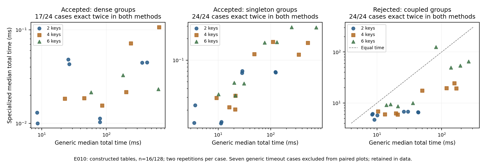

# Hướng đóng góp mới đã có thuật toán chạy được

Ngày 23-10-2026. Chưa nộp arXiv; đang phát triển nghiên cứu theo yêu cầu về tính mới.

Ứng viên đóng góp hiện tại gồm hai kết quả nối với nhau:

1. Muốn làm một ô đang bị từ chối được chấp nhận: có thể rút gọn chính xác
   các phương án sửa ở từng hàng, kể cả sửa khóa, mà không bỏ mất nghiệm tối ưu.
2. Muốn làm một ô đang được chấp nhận bị từ chối: có công thức trực tiếp.
   Khóa chỉ giúp giảm chi phí khi tồn tại một nhóm đơn lẻ có thể đưa hàng
   cạnh tranh vào với chi phí thấp hơn các cách lật nhóm còn lại.

Đây là hai chiều khác nhau của cùng câu hỏi về độ bền quyết định. Chúng chưa
chứng minh ô dữ liệu đúng hay sai. Chúng cũng chỉ áp dụng khi các luật dự đoán
cùng một cột, hàng mục tiêu được bảo vệ và mỗi ô sửa có chi phí bằng nhau.

Mình đã hoàn thành phép đo khóa trước thiết kế trên 72 bảng dựng sẵn: 2, 4
hoặc 6 cột khóa; 16 hoặc 128 hàng; hai kích thước miền giá trị; hai họ luật;
ba tình huống quyết định. Mỗi phương pháp chạy hai lượt, đổi thứ tự để giảm
ảnh hưởng thứ tự chạy. Trước đó, cả hai cách giải phải vượt qua 162 bài kiểm
tra nhỏ bằng duyệt đầy đủ mọi bảng có thể sửa.

| Tình huống | Kết quả |
| --- | --- |
| Đang chấp nhận, nhóm có nhiều hàng | Công thức hoàn tất cả 24 bảng; cách giải tổng quát hết thời gian ở 7 bảng trong cả hai lượt. |
| Đang chấp nhận, nhóm đơn lẻ | Cả hai giải chính xác đủ 24 bảng; công thức dùng ít thời gian hơn. |
| Đang từ chối, các nhóm tương tác | Cả hai giải chính xác đủ 24 bảng; thuật toán rút gọn nhanh hơn trung vị khoảng 3 lần, nhưng chậm hơn ở một bảng. |

Giới hạn một giây áp dụng cho phần tìm kiếm của bộ giải tổng quát, không gồm
thời gian dựng mô hình. Mọi kết quả hết thời gian vẫn được lưu; phương án tìm
được khi hết thời gian không bị gọi là tối ưu. Không có chi phí tối ưu nào
mâu thuẫn giữa hai phương pháp ở những lượt cả hai xác nhận được tối ưu.

Biểu đồ chỉ vẽ 65/72 bảng mà cả hai phương pháp giải chính xác trong cả hai
lượt. Bảy bảng còn lại vẫn nằm trong dữ liệu và bảng kết quả đầy đủ.

**Ý nghĩa hiện tại:** hướng mới đã vượt qua bước chỉ có ý tưởng hoặc kiểm tra
bảng tí hon. Có chứng minh, có phương án sửa cụ thể và có lợi ích tính toán
trên một thiết kế hữu hạn. Nhưng 128 hàng vẫn nhỏ, dữ liệu được dựng để kiểm
soát cấu trúc và phép đo mới trên một máy. Mình chưa suy ra hiệu quả chung
trên dữ liệu thực hay tuyên bố thuật toán luôn nhanh hơn.

**Bước tiếp theo:** kiểm tra ảnh hưởng của sửa khóa trên bảng dữ liệu có ý
nghĩa, đồng thời đối chiếu định lý với nghiên cứu gần nhất. Sau đó viết bài
quanh đóng góp phương pháp này, với các giới hạn nêu rõ. Những phần đã có
trước như biên phiếu, phản thực và tối ưu số sửa đổi sẽ được ghi công đầy đủ.

Nguồn: [kết quả đầy đủ](../experiments/E010-directional-scaling/results/run-e010-20261023-001.md),
[phân tích và trường hợp chậm hơn](../experiments/E010-directional-scaling/analysis.md),
[chứng minh công thức](../experiments/E009-singleton-characterization/theory.md).
